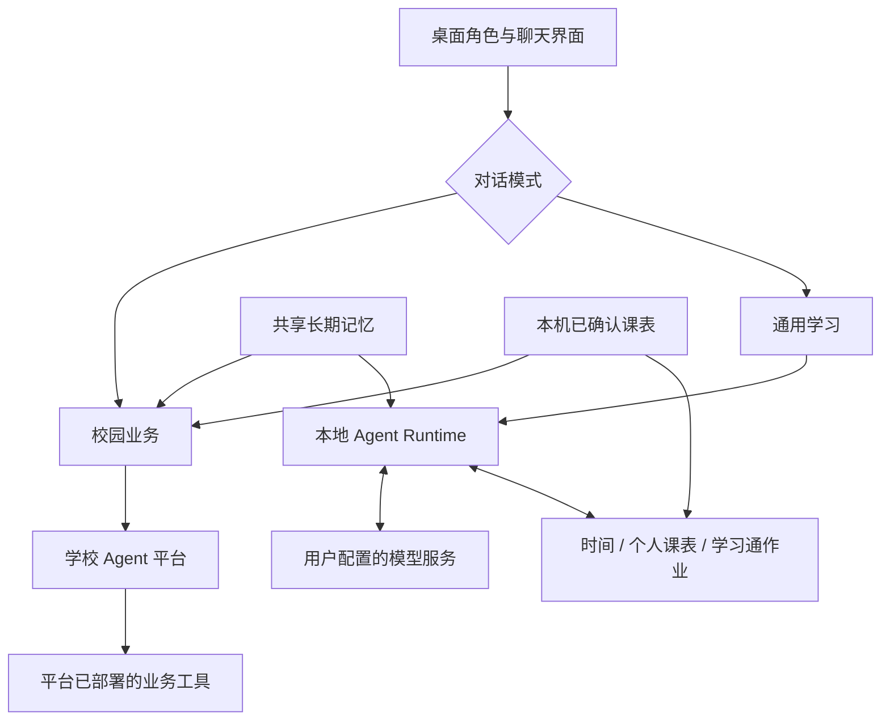

<p align="center">
  
</p>

<h1 align="center">智小理 · 校园伴行</h1>
<p align="center">从一句提问，到课表、作业与校园事务。</p>
<p align="center">Electron 桌面助手 · 双模式 Agent · 个人课表 · 学习通作业 · 共享长期记忆</p>

智小理把校园办事和日常学习放到桌面角色中。你可以查询自己的课表和学习通作业，也可以切换到校园业务模式，连接已有平台处理校车、会议室等事务。角色支持拖动、缩放、表情动作和回复朗读。

项目处于比赛展示阶段，目前公开的是源码。**通用学习调用用户配置的模型服务；校园业务需要对应学校平台的访问权限。** 仓库不提供模型密钥、学习通账号、校园后台或预构建安装包。

## 功能

| 能力 | 使用方式 |
| --- | --- |
| 通用学习 | 连接支持 Chat Completions 与工具调用的模型；完成学习问答，并按需读取时间、课表或作业 |
| 校园业务 | 对接已有校园 Agent 平台，承接校车、会议室等查询与预约；可用工具取决于平台实际部署 |
| 个人课表 | 图片/PDF 识别成草稿，人工核对后保存；支持手动录入、教学周和单双周 |
| 学习通作业 | 使用自己的账号，按课程查询作业名称、页面提交状态和完成进度；课程歧义时先确认 |
| 长期记忆 | 两种模式共用学生资料与近期事项；使用独立配置的百炼模型整理成功问答 |
| 桌面角色 | Canvas 2D 分层与网格动作、视线跟随、点击反馈、拖动缩放、在线朗读与音量驱动口型 |

聊天支持 **Enter 发送、Shift+Enter 换行**。处理请求时，发送按钮变为停止；查询进度显示在回复气泡中。两种模式分别保留当前会话，切换模式不取消另一边的请求；重启应用会新建普通会话，长期记忆和课表继续保留。

## 快速开始

主要开发与检查环境是 Windows。需要 Node.js **22.13.0 或以上**与 npm；具体 Node 版本范围以锁定依赖的引擎要求为准。

```powershell
git clone https://github.com/Limaoyu-007/zhixiaoli-campus-companion.git
cd zhixiaoli-campus-companion
npm ci
node start.js
```

`start.js` 会清除可能干扰 Electron 启动的 `ELECTRON_RUN_AS_NODE`。无需复制配置模板，应用会在本机初始化配置。

**第一次体验建议从通用学习开始：**

1. 打开设置 → 通用学习，填写模型厂家、兼容接口地址、模型名称和自己的 API Key，点击“保存更改”。
2. 切换到通用学习，问“现在几点”，确认模型与只读工具链路可用。
3. 再按需要配置个人课表、学习通和长期记忆。尚未配置记忆整理模型时，可先关闭长期记忆。

## 配置与使用

### 四组 API Key 独立配置

| 设置分类 | 用途 | 要求 |
| --- | --- | --- |
| 校园对话 | 访问校园 Agent 平台 | 需要对应平台的 API Key 和访问权限 |
| 通用学习 | 普通问答及工具调用 | Chat Completions 兼容接口，模型支持工具调用 |
| 长期记忆 | 整理学生资料与近期事项 | 独立的百炼兼容地址、Key 和整理模型 |
| 我的课表 → 课表识别配置 | 从图片/PDF 提取课表 | 独立的百炼地址、Key 和支持图片输入的视觉模型 |

**配置在设置页明文回显，填写后保存；清空后保存即删除。** 各模块不自动借用彼此的 Key，也不读取旧的 API Key 环境变量或 `campus.local.json` 作为回退。可以手动填写同一个兼容凭据，但每一项的配置来源都是明确的。

界面提供厂家和模型示例，实际可用性以账号的地域、套餐、接口及模型权限为准。远程模型接口使用 HTTPS；通用学习的本机回环接口允许 HTTP，未启用鉴权的本地服务可不填 Key。

### 个人课表

所有操作都在 **设置 → 我的课表** 中完成：

1. 配置课表识别模型，导入图片或 PDF；也可以直接手动添加课程。
2. 点击“识别为课表草稿”。识别前只保存该识别配置，不提交其它分类未完成的编辑。
3. 核对课程、星期、起止节次、上课周次和地点，补充第一教学周的周一、学期总周数及学校节次钟点。
4. 点击底部“保存更改”。**识别成功只代表生成草稿，保存后才用于聊天。**

校园模式每轮附上已确认课表；通用学习按需调用课表工具。资料缺失会提示待补充，不能据此判断“没有课”。课表不会自动同步教务系统，也不会根据校园通知自动改课。

示例提问：“今天有什么课？”“下周二上午的课在哪里？”

### 学习通作业

在设置 → 学习通保存自己的账号与密码，然后在通用学习中提问：

> 帮我查一下计算机网络的学习通作业。

首次查询时才登录；命中多个课程时先确认候选。当前只查询一个明确课程，不扫描全部课程，不读取题目或提交作业，也不补造页面没有提供的截止时间。验证码或额外验证会明确提示。

学习通密码由 Electron `safeStorage` 加密保存，页面不回填密码，Cookie 仅在内存中。详见[学习通工具说明](docs/CHAOXING_TOOL.md)。

### 长期记忆

在设置 → 长期记忆配置整理模型并启用。两种模式成功的原始问答进入同一待整理队列，生成学生资料与近期事项摘要；你也可以直接编辑或清空。

新会话首条消息前会尝试整理积压问答，独立超时上限为25秒；整理失败会使用已有记忆继续对话。普通上下文与长期记忆独立，关闭或修改记忆无法消除当前对话已经提到的信息，需要时新建会话。

### 校园业务

当前适配器连接重庆理工大学已有校园 Agent 平台，并校验既有证书指纹。**克隆本项目不会获得校园业务权限或后端服务。** 接入其它平台需要调整 `services/campus-agent-service.js` 及响应适配。

查询、预约等行为以平台实际工具结果为准。停止等待不代表撤销远端预约；结果不确定时，应先查询，再决定是否重试。

### 可选：回复朗读

朗读依赖 Python 和在线 `edge-tts`。安装 Python 后，在项目目录运行：

```powershell
python -m pip install --target .runtime/python -r requirements-tts.txt
```

Python 不在 PATH 时，可通过 `ZXL_TTS_PYTHON` 指定解释器路径。不需要朗读时，直接在设置中关闭。仓库不包含 Python 解释器或 `.runtime` 目录。

## 架构



校园模式的规划与业务工具由学校平台负责；通用学习的上下文、工具注册、参数校验、执行循环、取消和预算由本地 Runtime 管理。**本地 Runtime 不代表大模型在本机运行**，它作为 Electron 主进程模块调用配置的模型，无需独立 Java 或 HTTP 后端。

技术栈：Electron、Node.js/CommonJS、原生 HTML/CSS/JavaScript、Canvas 2D、Marked、DOMPurify、PDF.js、Cheerio。人物使用分层与三角网格变形，不依赖 Cubism/Pixi；Python 仅用于可选朗读。

| 路径 | 职责 |
| --- | --- |
| `main.js` / `preload.js` | 桌面生命周期、配置、受限 IPC 与双模式路由 |
| `renderer/` | 聊天、统一设置、课表编辑、语音播放与人物渲染 |
| `services/agent/` | 通用 Runtime、模型协议、只读工具、会话存储 |
| `services/chaoxing/` | 学习通登录、课程匹配、页面解析及内存 Cookie |
| `services/memory-service.js` | 共享学生资料、摘要及整理队列 |
| `services/campus-*.js` | 校园接口、会话、课表、日志与朗读 |
| `assets/brand/` / `assets/zhixiaoli/` | 品牌与当前角色素材 |
| `tests/` | 使用合成数据和本地 HTTP 服务的后端回归测试 |

进一步阅读：[开发上下文](CONTEXT.md) · [源码地图](CAMPUS_SOURCE_MAP.md) · [Runtime](docs/LOCAL_AGENT_RUNTIME.md) · [课表](docs/CAMPUS_TIMETABLE.md) · [记忆](docs/CAMPUS_MEMORY.md)

## 本地数据与外部请求

为兼容早期版本，默认数据目录是 `app.getPath('appData')/open-desktop-pet`，Windows 通常为 `%APPDATA%\open-desktop-pet`；也可通过 `--user-data-dir` 指定独立目录。

| 数据 | 存储方式 |
| --- | --- |
| 模型、界面、语音配置 | `config.json`；API Key 保存在本机配置中，并在设置页明文展示 |
| 共享长期记忆 | `campus-memory.json` |
| 两种模式会话 | `campus-session.json`、`study-session.json` |
| 课表与原件副本 | `campus-timetable.json`、`timetable-source-*` |
| 学习通密码 / 登录态 | 密码使用系统安全存储加密；Cookie 仅保留在内存 |
| 开发日志 | 数据目录 `logs/`；开启后记录脱敏的对话和执行信息 |

API Key 仅通过设置窗口的专用 IPC 明文回显，聊天页与配置广播不接收密钥。

外部请求的数据范围：

- 聊天模型接收当前问题、选取的上下文、启用的记忆及相关工具结果。
- 课表视觉模型接收所选课表图片；记忆整理模型接收待整理问答。
- 学习通凭据只用于主进程向学习通登录，不发给模型；在线朗读服务接收朗读文本。

仍支持的环境变量：`CHAOXING_PHONE` / `CHAOXING_PASSWORD`（成对覆盖学习通设置，不混用来源）、`ZXL_TTS_PYTHON`（Python路径）。模型 API Key 请直接在各自设置页填写。

真实配置、账号、会话、课表、日志、测试缓存、依赖和构建输出不纳入公开仓库。[空配置示例](config.example.json)仅用于了解结构。

## 检查与打包

```powershell
npm test                # 后端回归；合成数据、本地HTTP，无需真实账号或模型Key
npm run build           # Windows NSIS安装包
npm run build:portable  # Windows便携版
```

打包输出位于 `dist/`。修改品牌 SVG 后，可运行 `npm run make-icons` 生成 PNG/ICO。打包命令可用不代表已生成或验收安装包；本次源码发布不附带安装程序。

2026-10-27 收尾检查：12项后端回归、14项独立 Electron 交互检查和33个脚本语法检查通过。交互检查使用合成课表和受控模型响应，后端测试另验证本地HTTP请求；**不代表真实外部模型、校园平台或全部学习通账号/课程均通过验收。**

目前未提供网页搜索、任意文件/Shell 操作、全课程待办汇总、定时自主任务或教务系统同步。

## 来源与许可

基于 [OpenDesktop-Pet](https://github.com/HanLoney/OpenDesktop-Pet) 改造，保留适用版权及第三方许可证。应用源码使用 [Apache License 2.0](LICENSE)，修改及依赖声明见 [NOTICE](NOTICE)。

角色立绘与分层图片由项目使用者提供，许可独立于应用源码；本仓库不授予这些素材的额外使用或再分发权利。旧版 Live2D 模型、Cubism/Pixi 运行库与原项目 Logo 不包含在当前版本中。
