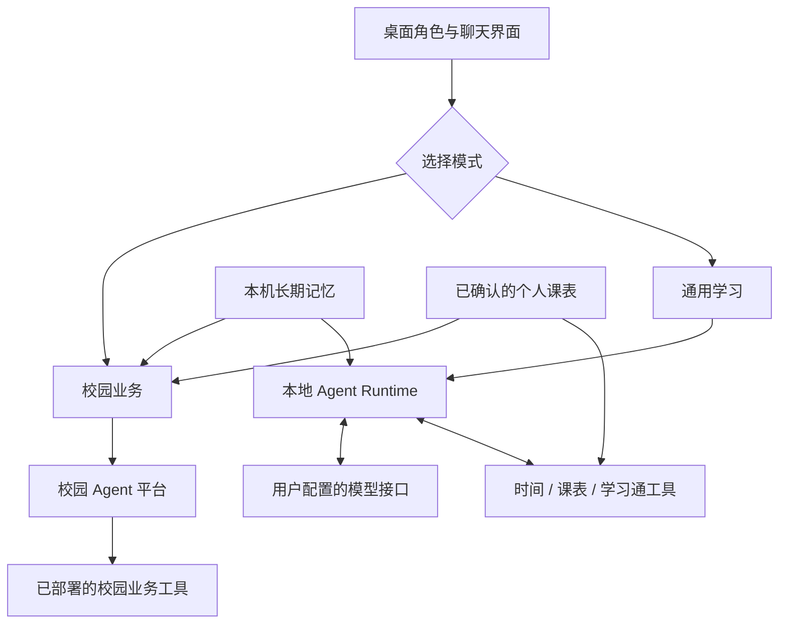

<p align="center">
  
</p>

# 智小理·校园伴行

把校园办事与日常学习放到桌面上的 AI 助手。

智小理以桌面角色为交互入口，提供**校园业务**和**通用学习**两种模式：前者连接校园 Agent 平台，后者通过自建本地 Runtime 调用用户配置的大模型和本地工具。两种模式共用个人课表与长期记忆，让对话既能回答问题，也能结合学生自己的信息处理实际任务。

> 当前为比赛展示阶段的源码版本。2026-10-24 用户已反馈学习通作业查询可用，本阶段功能范围收尾。仓库不附带校园平台权限、模型密钥、个人账号数据或新构建安装包。

## 可以做什么

| 能力 | 当前实现 |
| --- | --- |
| 校园业务 | 连接已有校园 Agent 平台，承接会议室、校车等查询与预约；实际业务工具和权限由平台部署决定 |
| 通用学习 | 连接支持 Chat Completions 和工具调用的模型接口，执行本地工具并将结果回传模型 |
| 学习通作业 | 登录自己的账号，按课程名查询作业名称、页面状态、完成进度；重名课程先询问用户选择 |
| 个人课表 | 图片/PDF 识别为草稿，人工核对后保存；也可手工录入，按日期和教学周查询 |
| 长期记忆 | 两种模式共用学生资料、近期摘要和记忆开关；自动整理使用独立配置的模型 |
| 桌面陪伴 | 透明桌面窗口、拖动缩放、视线跟随、表情与动作、回复朗读及音量驱动口型 |

人物采用 **Canvas 2D 分层与三角网格变形**，无需安装 Cubism 编辑器。当前素材和动画已收尾，不包含正式 Cubism 模型。

## 两种模式如何工作



通用学习的上下文、工具注册、执行循环、取消及预算控制由本项目管理；校园业务的规划与执行由原平台负责。Runtime 位于 Electron 主进程，无需另起 Java 服务或 HTTP 后端。

两种模式各自维护近期会话，每次重启新建会话，长期记忆继续保留。切换模式不会取消另一模式正在执行的请求，回复按所属会话显示。

## 快速开始

主要开发环境为 Windows。安装 Node.js（项目 PDF.js 包声明要求 Node.js 22.13.0 或以上）及 npm，克隆后运行：

```powershell
git clone https://github.com/Limaoyu-007/zhixiaoli-campus-companion.git
cd zhixiaoli-campus-companion
npm ci
node start.js
```

`start.js` 会清除 `ELECTRON_RUN_AS_NODE`，再启动项目自带的 Electron。无需复制配置模板，应用会初始化本机配置。

### 配置通用学习

1. 打开设置 → **通用学习**，填写厂家、兼容接口地址、模型和 API Key，点击“保存更改”。
2. 在聊天输入区上方切换到 **通用学习**。
3. 可先问“现在几点”，再配置个人课表或学习通。

内置千问、DeepSeek 和其他兼容接口选项。模型必须支持所选接口的工具调用协议；本地 Runtime 不等于模型在本机运行，使用云端接口时需要网络。

### 查询学习通作业

在设置 → **学习通**保存自己的账号与密码，然后在通用学习模式输入：

> 帮我查一下计算机网络的学习通作业。

首次查询才发起登录；课程匹配到多项时，先按候选确认。当前只查询一个明确课程，不包含全课程扫描、截止时间、题目读取或作业提交。配置、错误和源码说明见 [学习通工具](docs/CHAOXING_TOOL.md)。

### 配置课表与记忆

- **我的课表**：导入图片/PDF，识别并核对课程、周次、节次与学期起点，再保存。识别需配置支持视觉输入的百炼模型，也可直接手工录入。[课表说明](docs/CAMPUS_TIMETABLE.md)
- **长期记忆**：启用后注入已保存的学生资料与摘要；自动整理需单独配置百炼记忆模型，不随普通聊天厂家切换。[记忆说明](docs/CAMPUS_MEMORY.md)
- **校园业务**：需拥有对应校园平台的访问权限及 API Key。当前适配器使用既有平台地址与证书指纹；接入其他平台需调整适配器，克隆仓库不会取得平台权限。

### 可选：回复朗读

朗读使用 Python 与在线 `edge-tts`。已安装 Python 后，在项目目录运行：

```powershell
python -m pip install --target .runtime/python -r requirements-tts.txt
```

Python 不在 PATH 时，可用 `ZXL_TTS_PYTHON` 指定解释器绝对路径。不使用朗读时，在设置里关闭即可。仓库不包含 Python 解释器或 `.runtime` 依赖目录。

## 源码从哪里读

| 路径 | 职责 |
| --- | --- |
| `main.js` | Electron 窗口、配置、受限 IPC、双模式请求路由与共享服务 |
| `preload.js` | 页面与主进程的通信桥 |
| `renderer/` | 聊天、设置、课表编辑和 Canvas 人物绘制 |
| `services/agent/local-agent-runtime.js` | 模型请求、上下文、工具循环、取消和执行预算 |
| `services/agent/model-provider.js` | Chat Completions 兼容接口适配 |
| `services/agent/study-tools.js` | 本地工具定义、参数校验、名称白名单和执行入口 |
| `services/chaoxing/` | 学习通客户端、内存 Cookie、HTTPS 请求与页面解析 |
| `services/memory-service.js` | 学生资料、摘要和问答整理 |
| `services/campus-*.js` | 校园平台、校园会话、课表、日志与朗读 |
| `assets/brand/` | 项目标志与应用图标 |
| `assets/zhixiaoli/` | 当前角色立绘和分层素材 |

添加通用学习工具时，从 `study-tools.js` 开始：补充模型可见的定义、参数约束、中文名称和执行分支，再注入所需的独立客户端。现有工具为 `get_current_time`、`get_timetable`、`list_homework`。

技术栈：Electron、Node.js/CommonJS、原生 HTML/CSS/JavaScript、Canvas 2D、Marked、DOMPurify、PDF.js、Cheerio；Python 仅用于可选朗读。主链没有使用 Vue 或额外 Agent 框架。

详细入口：[开发交接](CONTEXT.md) · [源码地图](CAMPUS_SOURCE_MAP.md) · [Runtime 说明](docs/LOCAL_AGENT_RUNTIME.md) · [阶段总结](docs/PROJECT_SUMMARY_20261024.md)

## 本地数据与外部请求

为兼容早期版本，默认数据目录继续使用 `app.getPath('appData')/open-desktop-pet`，Windows 通常是 `%APPDATA%\open-desktop-pet`。显式指定 `--user-data-dir` 时沿用自定义目录。

| 数据 | 保存方式 |
| --- | --- |
| 模型、界面、语音配置 | `config.json`；模型 Key 当前保存在本机配置中，可用环境变量覆盖 |
| 共享长期记忆 | `campus-memory.json` |
| 两种模式近期会话 | `campus-session.json`、`study-session.json` |
| 已确认课表与原件副本 | `campus-timetable.json`、`timetable-source-*` |
| 学习通登录态 | Cookie 仅保存在内存；密码通过 Electron `safeStorage` 加密保存 |
| 可选开发日志 | 数据目录下 `logs/`，包含脱敏后的对话与执行信息 |

模型调用会把当前问题、选取的上下文、启用的记忆及所需工具结果发给配置的模型服务；课表识别会发送选中的图片，记忆整理会发送待整理问答；朗读文本会发给在线语音服务。学习通账号与密码只用于主进程向学习通登录，不作为工具参数或模型上下文。

可用环境变量：

| 变量 | 用途 |
| --- | --- |
| `ZXL_STUDY_API_KEY` | 通用学习模型 Key |
| `ZXL_API_KEY` | 校园平台 Key |
| `DASHSCOPE_API_KEY` | 百炼记忆与课表识别 Key |
| `CHAOXING_PHONE` / `CHAOXING_PASSWORD` | 成对覆盖学习通设置，不与另一来源的凭据混用 |
| `ZXL_TTS_PYTHON` | Python 解释器路径 |

真实配置、会话、日志、课表、`.env`、依赖目录和构建输出不纳入公开仓库。可分享的空配置示例见 [config.example.json](config.example.json)。

## 打包

```powershell
npm run build           # Windows NSIS 安装包
npm run build:portable  # Windows 便携版
```

输出位于 `dist/`。修改品牌 SVG 后，可运行 `npm run make-icons` 生成 PNG/ICO。打包脚本已保留；2026-10-24 收尾没有重新构建或发布安装包，也没有进行跨平台验收。

## 当前范围

目前交付聚焦桌面交互、双模式对话、共享记忆、课表和指定课程作业查询。未实现网页搜索、任意文件/Shell 操作、全课程待办汇总或定时自主任务。停止等待校园请求不代表撤销远端预约，结果不确定时应先查询。

真实模型兼容性、校园业务权限及学习通页面变化以各自环境为准。用户已反馈本机作业查询可用；这不代表所有账号、课程、平台或全量功能均经过验收。本次文档与公开发布未运行测试或构建。

## 来源与许可

本项目基于 [OpenDesktop-Pet](https://github.com/HanLoney/OpenDesktop-Pet) 改造，保留适用的原作者版权与第三方许可证。应用源码采用 [Apache License 2.0](LICENSE)，修改范围与第三方来源见 [NOTICE](NOTICE)。

角色立绘和分层图片由项目使用者提供，与应用源码许可分开；本仓库不授予其额外授权，复用或再分发素材前需自行确认相应权利。旧版 Live2D 模型、Cubism/Pixi 运行库和原项目 Logo 已从当前版本移除。
