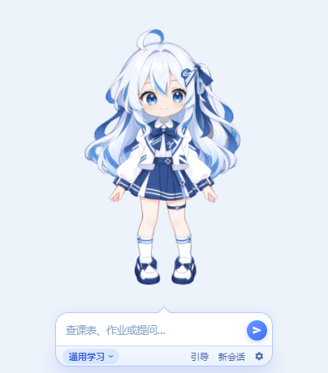
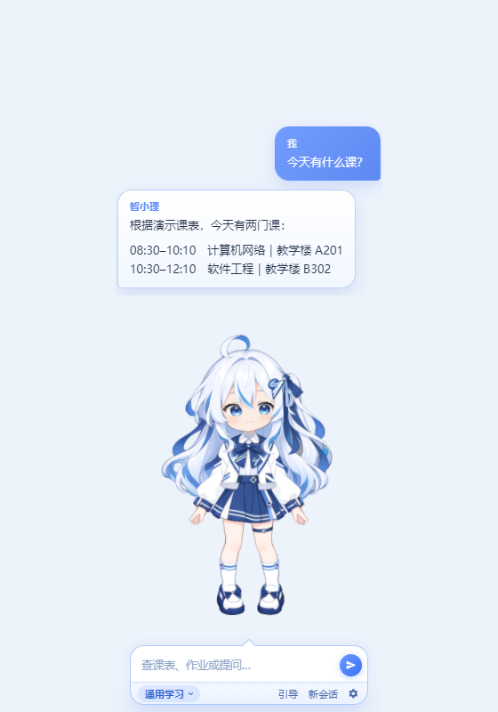
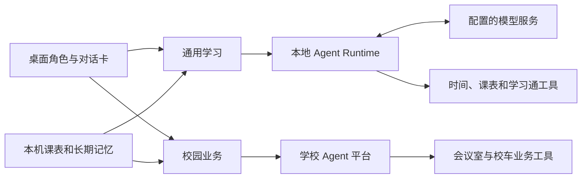

# 智小理·校园陪伴

面向高校学生的 Windows 桌面助手。点击桌面角色打开对话卡，可查看个人课表、查询指定课程的学习通作业，也可切换到校园业务模式，查询会议室和校车班次。

本仓库是参赛作品的源码入口。评审可以先看下方截图，再按快速启动说明体验。公开源码默认使用 Canvas 角色，截图中的 Live2D 形象来自参赛演示环境。通用学习需要可用的模型服务，校园业务需要学校平台权限。

## 作品截图

| 桌面角色与对话卡 | 查询今日课表 |
| --- | --- |
|  |  |

课表截图使用合成课程数据和演示模型响应，桌面应用实际调用了本地课表工具。

[功能使用引导](docs/screenshots/setup-guide.png) · [个人课表管理界面](docs/screenshots/timetable-settings.png)

## 快速启动

适用环境为 Windows，需安装 Git、Node.js 22.13.0 或以上版本及 npm。

```powershell
git clone https://github.com/Limaoyu-007/zhixiaoli-campus-companion.git
cd zhixiaoli-campus-companion
npm ci
node start.js
```

启动后点击桌面角色展开对话卡。配置完成后按 Enter 发送，Shift+Enter 换行。仓库提供源码和依赖锁文件，评审使用自己的模型配置；学校平台和学习通需要对应的账号或授权。

1. 在「设置 → 通用学习」填写 Chat Completions 兼容接口、模型名称和 API Key，保存后切到通用学习模式，输入「现在几点？」。使用本机无鉴权模型服务时，API Key 可留空。
2. 在「设置 → 我的课表」填写第一教学周周一、节次时间和课程信息，点击「保存更改」，再问「今天有什么课？」。也可配置视觉模型，导入图片或 PDF 生成草稿，核对后保存。
3. 在「设置 → 学习通」配置自己的账号后，输入「查一下计算机网络的学习通作业」，将课程名换成自己的课程。
4. 如有学校平台访问权限，在「设置 → 校园对话」填入平台配置，切到校园业务模式，可先体验会议室可用时段或校车班次查询。

## 功能与实现

| 能力 | 实现方式 |
| --- | --- |
| 桌面互动 | Electron 透明窗口与原生 HTML、CSS、JavaScript 界面，点击角色打开或收起云朵对话卡。 |
| 通用学习 | 主进程内的 Agent Runtime 连接模型，校验参数并执行时间、课表、指定课程作业查询工具。 |
| 校园业务 | 对接学校 Agent 平台，由平台调用已有业务工具，预约规则和实际结果由业务系统处理。 |
| 课表管理 | 图片或 PDF 识别生成草稿，支持手动录入，确认后根据学期日期、教学周和节次查询。 |
| 学习通作业 | 按课程读取作业名称和页面状态，同名课程由用户选择。 |
| 长期记忆 | 可选的整理模型从成功问答提取学生资料和近期摘要，用户可查看、修改、清空或关闭。 |



两种模式独立管理会话与请求。课表、会话和记忆保存在本机，Windows 默认数据目录为 `%APPDATA%\open-desktop-pet`。学习通密码由 Electron 系统安全存储加密，登录凭据由主进程使用。配置视觉识别或记忆整理后，对应服务会收到用于识别的课表图片或用于整理的对话内容。

## 代码导航

| 路径 | 职责 |
| --- | --- |
| `main.js`、`preload.js` | Electron 生命周期、窗口、IPC 与服务装配 |
| `renderer/` | 桌面角色、聊天、设置与课表编辑 |
| `services/chat-coordinator.js` | 双模式会话、请求取消与回复事件 |
| `services/agent/` | 学习模式 Runtime、模型协议和工具 |
| `services/chaoxing/` | 学习通登录、课程匹配和作业解析 |
| `tests/` | 使用合成数据的后端回归测试，可用 `npm test` 运行 |

[源码地图](CAMPUS_SOURCE_MAP.md) · [Runtime](docs/LOCAL_AGENT_RUNTIME.md) · [课表](docs/CAMPUS_TIMETABLE.md) · [长期记忆](docs/CAMPUS_MEMORY.md) · [公开范围](docs/PUBLIC_RELEASE.md)

## 来源与许可

基于 [OpenDesktop-Pet](https://github.com/HanLoney/OpenDesktop-Pet) 改造。应用源码采用 [Apache-2.0](LICENSE)，原作者和依赖声明见 [NOTICE](NOTICE)。角色素材的许可独立于源码。参赛 Live2D 工程、导出模型和运行库由演示环境单独管理，公开版的形象差异见 [角色实现说明](docs/CAMPUS_LIVE2D.md)。
